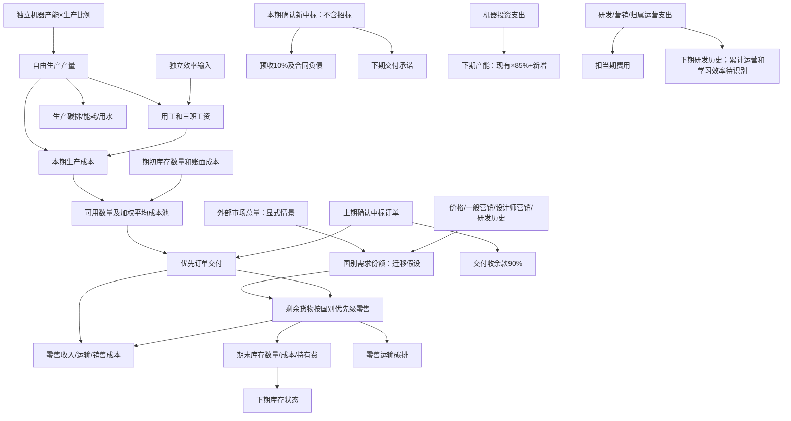

# 连接件V2：库存、订单和影响路径

2026-10-13。公共入口仍是`t3v1.predict_joint`，独立生产入口是`connector_free_production.project`。启用`connector_plan.lifecycle`后使用`CONNECTOR_LIFECYCLE_V2`；原输入及同曲线基准保留。新增数据来自正式3归档，预算不是实际训练标签，连接件真实训练样本仍为0。

## 影响路径



需求只限制交付，不截断指定的自由生产。已确认订单先于零售；库存加生产不足以履约时直接报错，不擅自补罚款或缩减订单。350千单位是招标机会，不自动加入需求、收入或订单状态。

加权平均单位成本=(期初库存账面成本+本期材料+工资)/(期初数量+本期产量)。订单和零售同时转出销售成本，剩余账面成本结转。研发、营销、归属运营费用扣除一次；运营费用只有明确归属于连接件的部分才能填写，不能将共同投入重复扣给两产品。

`operating_contribution_kusd`为收入减销售成本、运输、持有费及归属费用；`contribution_kusd`保留资源贡献口径，按本期生产支出扣除。这两者的差额等于期末减期初库存账面成本。投资列为支出，不一次性扣成当期经营费用。订单预收是负债和现金，不计销售收入；订单交付时确认全额收入，同时收余款、释放旧预收负债。

## 输入及跨期结转

在原四项`connector_plan`字段之外增加完整的`lifecycle`，金额为千美元、数量为千单位、单价为美元/单位：

```json
{
  "opening_inventory_book_value_kusd": 0,
  "orders_due": [],
  "orders_awarded": [],
  "rd_kusd": 0,
  "marketing_kusd": 0,
  "attributed_operations_kusd": 0,
  "investment_kunits": 0,
  "investment_unit_cost": 1.10,
  "capacity_decay_pct": 15
}
```

这些字段均须显式提供；未知库存账面成本不能填0。空订单列表表示显式假设无确认订单。每个订单需要`status: "CONFIRMED"`、`quantity_kunits`、`price`、`advance_received_kusd`，预收须等于合同价款10%；报价和招标不是确认订单。

`next_state`返回库存、确认订单、产能及上一期研发投入。下期将数量用于`connector_plan.opening_inventory_kunits`，将`next_state.lifecycle`中的账面成本与订单覆盖到**重新填写的下期完整lifecycle**，将产能用于`production.连接件.capacity`。下期费用、投资、价格、效率和新订单必须另给；不能原样重复上期费用或新中标。直接合并`next_state`会得到仅含继承状态的不完整lifecycle，缺少当期条件时会拒绝计算。

下期需求输入的`previous_rd`使用上期`rd_kusd`。当期研发/营销支出还须与需求竞争输入保持一致，效率和归属费用仍由调用方完整提供；现有模型没有自动识别累计运营或学习效应的定量函数。多个产品联动时仍预留连接件固定计划用工，再优化复合梁；两个产品的机器产能不混用。

可选`environment_per_unit`字段包含`production_co2_kg`、`energy_kwh`、`water_l`、`domestic_transport_co2_g`、`export_transport_co2_g`。正式3公布参数为2.30、7.89、18.56、6.2、74.5；环境输出按实际生产/零售交付数量换算，订单运输环境数据保持未知。

## 独立研发曲线敏感性

默认`connector_rd_mode: "tied"`继续同曲线基准。新注册表提供`observed_connector_rd`后，可显式使用`connector_rd_mode: "observed_sensitivity"`，接入正式3连接件独立200点曲线。复合梁输入和响应保持不变；有效研发投入超过1600千美元时拒绝外推。

这只是单独替换图线的敏感性情景，价格/营销行为系数及研发历史权重仍迁移自复合梁，未经连接件实际验证，不能称为独立训练。原文称连接件行业规模价格敏感度较小，只支持定性约束，不提供精确弹性，也不能直接推出本队份额价格弹性。行业营销扩张、跨产品替代、学习效应和累计运营暂不编造系数。

## 验证与限制

`work/verify_connector_model_v2.py`逐次创建新验收目录，保存来源参数、注册表、完整输入/输出、两期演示、研发及效率敏感性、代码快照和哈希。包含库存成本守恒、订单优先、预收不计收入、下期产能、订单不足/非法状态拒绝、费用扣除、共享用工、环境单位、旧冻结预测逐值回放及原件不变检查。

加权平均计价、期末数量计持有费、投资下期生效仍属情景假设。当前贡献未纳入折旧、税、利息、共享固定费、零售收款/生产支付时点、订单违约处罚、终局库存价值及完整六回合优化。正式3文本年利率5%与参数基准4%的冲突未解决；本次不据此生成贷款或净利润预测。未修改平台决策。
