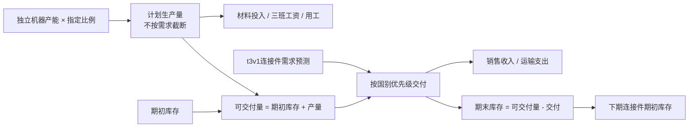

# 连接件独立自由生产路径

2026-10-13后续版本：[V2库存、订单及影响路径](CONNECTOR_V2_库存订单及影响路径.md)已支持显式生命周期输入、库存成本结转情景及确认订单。下文保留V1历史范围，V2未补成完整净利润或六回合最优。

版本：`CONNECTOR_FREE_PRODUCTION_V1`，2026-10-13。复用t3v1需求参数，不重训需求，不覆盖原训练交付。[验收报告](../output/connector_free_production/20261013T194825493581+0800/report.md)、[完整输入](../output/connector_free_production/20261013T194825493581+0800/request.json)、[结果](../output/connector_free_production/20261013T194825493581+0800/prediction.json)、[两期数量演示](../output/connector_free_production/20261013T194825493581+0800/next_round_inventory_demo.json)。

## 来源与正式3前景提示

“自由生产”直接依据[生产策略帮助原件](../raw/20261011_production_strategy_help.txt)：由管理层决定生产，允许产品生产到库存。正式3生产页的连接件采用自由生产，复合梁采用需求驱动。该规则不由“单产品曲线相同”假设推导。

正式3[前景归档](../output/round_close/20261012T221044.031+0800/resume/20261013T_goal/current_2026-10-13T082849281Z/raw/outlook.json)未直接写“自由生产”，但给出连接件约27美元的价格、泰国/印尼250/150千单位的初始需求估计、每员工16–18千单位的生产效率，以及350千单位连接件大客户招标。参数表另给材料14.20美元/单位、运输0.50/2.00美元/单位、库存持有成本0.60美元/单位。这些是独立需求/生产/成本/后续交付的条件，招标不是已中标订单，350千单位不直接加进需求或销量。

## 独立计算路径



给定产能`C`、计划比例`a`、生产效率`η`，`Q=C×a/100`，人数`N=Q/η`。材料支出按`Q×材料单价`；工资按各班次产量与乘数计算。需求仅限制交付，不限制Q。

以给定国别优先级逐国计算`销量=min{本国需求，剩余可交付量}`。收入按销量计算，期末库存由数量守恒得到；`next_state.opening_inventory_kunits`可直接作为下期计划的期初数量。无生产但有库存时仍能交付，生产材料投入和用工为0。

持有费用暂以`期末数量×输入持有单价`作显式情景假设，实际平台的计费数量基础仍待验证。库存账面价值保持未知，不把全部期初库存当成成本为0的利润。输出`contribution_kusd`仅是收入减本期生产、运输与指定持有支出的资源差额，尚未扣除期初库存成本转出，不能作为会计净利润或实际现金流。

## 接入联合分配

在t3v1请求JSON中增加：

```json
"connector_plan": {
  "allocation_pct": 80,
  "opening_inventory_kunits": 5,
  "holding_cost_per_unit": 0.6,
  "country_priority": ["泰国", "印尼"]
}
```

四项均需明确提供，不把缺失库存补零。连接件产能、效率、需求、售价和成本仍来自`production.连接件`与需求预测。先按固定连接件计划预留共享用工，再在剩余用工内优化复合梁；若连接件计划本身超过用工上限，报错，不偷偷缩减连接件产量。输出模型标识为`JOINT_ALLOCATION_CONNECTOR_FREE_V1`，重新计算两产品数量占比与用工占比。

未提供`connector_plan`时，为兼容旧输入，仍运行原零库存、当期交付优化路径；不会自动启用连接件备货，不能用该输出模拟已填写的自由生产计划。本版本评估指定的备货比例，尚不自动寻找跨回合最优备货比例。

## 验证与边界

100产量、40需求→销售40、库存60；下期零生产可从库存交付；材料和工资均按实际计划产量计算。独立测试还覆盖国别优先级、零产能、非法比例、固定计划占用共享用工、用工不足拒绝及完整t3v1预测入口。验收演示连接件产能80、计划80%，产量64千单位，期初库存5，期末约38.295175千单位；均属合成情景，不是本人当前推荐。

需求模型同曲线假设保留，但生产策略不共用。尚未接入库存计价及成本转出、大客户中标/交付、预付款、完整现金/税/利息与剩余回合库存价值；不宣布跨期收益最优。原t3v1模型和产物保留。
