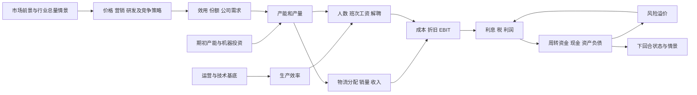

项目总入口：[README](README.md)。本页保留专题证据，当前总进展与待办以README及最新归档为准。

# 正式1分步建模与隐藏函数拟合

更新：2026-10-11（北京时间）。全部预测、拟合、情景和财务计算均由Python执行。

已读取引用聊天的隐藏函数分析，并实时确认市场5、营销团队、正式1、PYT个人区域。当前个人需求2.5/11、小组5/11；网页采集前后每个表格单元格相同，没有修改或提交决策。

本轮完成可识别部分的拟合与分步计算。对缺少可识别样本的分支明确保留未知，不能声称已还原全部平台隐藏函数。

## 计算顺序

每个网页输入的公式、依赖和识别状态见 [分步模型清单](预测与决策_分步模型清单.csv)。清单覆盖市场增长、两国需求、下回合需求增长、效率、贷款利率、价格、两类营销、大客户、物流、产能分配、机器投资、运营、研发和融资。

## 需求：从绝对数量回归改为竞争份额模型

`utility = -e国*log(P/P0国) + bg*log1p(G合计/1000) + bd*log1p(M合计/1000) + br*log(f_rd(R+0.5*Rprev))`

`share_i = exp(utility_i)/sum_j(exp(utility_j)); D_i = 行业总需求*share_i`

行业规模与竞争份额分开计算；份额合计为1。训练只用实际需求，缺货销量不能替代需求。研发上期值补入初始0的600，不再把练习1上期投入默认为0。国别营销仍缺失，只使用合计代理。

参数选择仅在练习1内部团队留出完成；验证采用练习1训练、练习2检验。公式设计已参考现有练习2资料，因此这仍是回溯验证。真实正式结果尚未发生，未来泛化需要独立验证。

| 模型/检验 | MAE，千单位 | WAPE |
| --- | ---: | ---: |
| 旧版冻结前向候选 | 1.419 | 14.56% |
| 新版：上期行业增长外推+条件竞争策略 | 0.922 | 9.46% |
| 新版等份额基线：同样行业规模预测 | 1.829 | 18.76% |
| 新版份额诊断：给定验证期真实总量 | 0.862 | 8.84% |

**最后一行用到验证期实际总量，仅诊断份额模型，不是可实现的预测分数。**其他新版验证也以已实现的竞争者策略为条件。正式1竞争策略未知，必须给定情景；新旧对比不等于完全相同信息集的独立竞赛。

嵌套团队留出份额MAE为 0.816 个百分点。参数与每条预测、来源行列均保存在JSON；系数表示关联，不能宣称平台真实价格弹性。

| 冻结练习1系数 | 值 |
| --- | ---: |
| 泰国价格弹性 | 4.678137 |
| 印尼价格弹性 | 2.354330 |
| 合计一般营销代理 | 0.389676 |
| 合计设计师营销代理 | 0.071733 |
| 研发曲线作用 | 0.321454 |

### 当前各项预测的情景值

下表固定当前价格与投入；竞争者使用初始0/练习1策略假设，行业规模取不增长/历史练习1增长。范围是情景端点，不是统计置信区间，也不是正式实际值。

| 预测字段 | 当前手填值 | 模型情景 |
| --- | ---: | --- |
| 泰国公司需求，千单位 | 2.50 | 0.405–0.444 |
| 泰国市场增长，% | 0.00 | 0.00–7.431，给定情景 |
| 印尼公司需求，千单位 | 11.00 | 11.625–12.577 |
| 印尼市场增长，% | 0.00 | 0.00–3.544，给定情景 |
| 生产效率，千单位/人 | 0.15 | 0.169790，条件点预测 |
| 下回合公司总需求增长，% | 0.00 | -0.135–10.628，未来情景传播 |
| 长期贷款利率，% | 3.00 | 3.2483，联立条件点预测 |

下回合采用0/5/10%增长或历史练习1→2增长、竞争策略不变、研发跨期传递的明确假设。正式2前景未取得，这些未来假设不能当作已知信息。泰国当前手填需求明显高于模型情景值，应视为需要验证的偏差；此处没有修改输入。

行业总量仍是最薄弱环节：只有两个练习回合，不能同时识别宏观趋势、行业价格、营销和隐藏规模函数。验证期总量预测使用 `M1*(M1/M0)`；正式1情景使用初始规模不变与历史练习1增长两种假设。下回合需求增长必须从下回合行业/竞争情景推导，不能把截图50%或当前0%当作已知增长。

## 研发与运营曲线

本次从正式1生产页读取可见SVG线条和坐标轴，未读取平台内部模型状态。每条曲线200个顶点，以交错100个顶点拟合、另100个检验，随后用全曲线拟合最终参数。横轴刻度显示为整数，存在约±0.5千美元的标定误差；这些顶点不是200次独立实验。

研发：`f_rd(x) = -0.029189 + 0.278970*(x+0.750996)**0.204058`。

运营：`f_ops(x) = 0.450000 + 0.750000*x/(400.105820+x)`。

曲线留点最大误差：研发 0.004648、运营 6.66e-16（乘数单位）。仅说明可见曲线近似好；有效投资如何由历史投入累积而来、国别权重及实际需求效应仍需检验。

效率模型采用 `tech*f_ops(O+0.5*Oprev)`，练习1拟合技术尺度，练习2前向MAE为 0.000476 千单位/人。实际效率标签使用实际产量/工人数，避免把显示为0.17的两位小数当作精确效率。rho=0/0.5/1均保留为敏感性；0.5沿用事前假设，没有按验证误差挑选。

## 生产、投资和财务链

| 项目 | Python公式 | 核验范围 |
| --- | --- | --- |
| 当期产能 | 上期产能×0.85+机器投资千单位 | 两练习回合20队次，投资当回合生效 |
| 产量 | min(产能×分配比例, 总需求) | 零期初库存/零大客户的需求驱动策略 |
| 工人/工资 | q/效率；按产能的三个1/3班次，用1、1.65、2.56工资系数 | 历史校验使用实际人数，不冒充独立效率验证 |
| 解聘 | max(上期人数×0.9−本期人数,0)×工资×0.35 | 20队次 |
| 应收/应付 | 收入×30/365；原材料×30/365 | 20队次 |
| 厂房折旧 | 期初账面值×7% | 当前场景经验拟合 |
| 机器折旧 | (期初账面值+当期投资)×15% | 20队次，含投资变化 |
| 厂房投资 | 800千美元 | 当前归档各队一致，未证明所有规模/回合恒定 |
| 长期利息 | (期初贷款+期末贷款)/2×利率 | 给定实际利率的金额核验 |
| 现金利息 | (期初现金+期末现金)/2×1% | 与现金和所得税联立，不引用未来实际现金 |
| 税费 | max(税前利润−已知累计税亏,0)×29% | 只有盈利/亏损状态，没有亏后转盈样本 |
| 资产负债 | 期末资产=权益+贷款+应付 | 独立计算链自检 |

原材料使用公布单价加练习1拟合单位差额 1.176471 美元/单位；练习2前向原材料总额MAE 4.661 千美元。差额未解释，不把经验值改称官方原材料参数；数量显示舍入亦有影响。

历史公式核验共 240 项，0 项超过明示容差。这是多个单项关系核验，部分使用实际中间量，不是全部独立的财务前瞻预测。税费的0.65千美元容差来自税前/税额整数显示误差传播：0.5×29%+0.5=0.645。

风险溢价分别拟合债务/权益幂函数与权益/资产指数函数。使用练习1拟合、练习2验证：

| 候选 | 训练MAE，基点 | 前向MAE，基点 |
| --- | ---: | ---: |
| leverage_power | 0.542 | 5.432 |
| solvency_exponential | 0.409 | 7.395 |

风险的条件验证使用实际期末资产/权益，仅用于诊断。情景预测另行联立预测利润、权益和利率，没有把未来实际财务状态输入预测。部署候选按练习1训练误差选择，不用练习2表现选型。短贷只有一条非零观测，不能唯一拟合计息时点；若预测现金不足2000，模型标记超出已识别范围。

## 当前正式1预算的独立回算

固定当前手填需求2.5/11、效率0.15、价格3000/2000、分配20%、其他个人输入不变。下表由期初状态和决策独立计算，原材料差额取练习1校准值；没有直接拿当前平台费用去拼利润。

| 指标 | Python | 平台 | 误差，千美元 |
| --- | ---: | ---: | ---: |
| revenue | 9300.000 | 9300.000 | +0.000 |
| materials | 3064.000 | 3064.000 | +0.000 |
| transport | 183.000 | 183.000 | +0.000 |
| long_interest | 510.000 | 510.000 | +0.000 |
| cash_interest | 143.278 | 143.000 | +0.278 |
| profit | -3648.360 | -3649.000 | +0.640 |
| machine_depreciation | 1313.250 | 1313.000 | +0.250 |
| building_depreciation | 921.200 | 921.000 | +0.200 |
| cash | 13651.542 | 13651.000 | +0.542 |
| ar | 764.384 | 764.000 | +0.384 |
| ap | 251.836 | 252.000 | -0.164 |

所有11项在明示容差内通过。输入2.5/11只是当前玩家预测，预算回算成功不能证明真实需求正确。

## 决策情景与单变量模型敏感性

本轮比较了 256 组价格/产能/物流情景；另有 23 组单变量模型反事实，覆盖研发、运营、机器投资、产能、贷款、物流和合计营销。它们没有写入网页，不是平台扰动试验。

保持当前营销、研发、运营、零机器投资和零贷款变化；两种竞争者策略假设×两种行业总量假设。效率由新模型预测；每组重新计算需求、产能分配与物流。下表按四种情景最小利润排序，仅表示有限网格内的条件结果。

| 泰国价格 | 印尼价格 | 情景利润最小值，千美元 | 情景利润最大值，千美元 |
| ---: | ---: | ---: | ---: |
| 1790 | 2500 | 2202.2 | 2759.4 |
| 1800 | 2500 | 2190.6 | 2753.9 |
| 1790 | 2400 | 2180.5 | 2734.2 |
| 1800 | 2400 | 2175.3 | 2728.7 |
| 1790 | 2600 | 2135.6 | 2753.6 |

上述是固定3%预算利率的比较；JSON另保存预测风险利率联立结果。网格最优泰国价格靠近训练下界，不能继续向低价外推寻找极值。营销代理、竞争未知、市场规模未知、未来投入收益与机器价格变化都可能改变排序，因此没有据此填写推荐决策，也没有称其为正式6累计收益最优。

## 仍未识别的内容

- 正式与练习隐藏需求函数是否相同：正式实际结果未出现，不能判定。
- 竞争者国别营销、营销延续、完整研发/运营存量：现有数据不能唯一分离。
- 市场总量和宏观环境函数：只有两个时间点，不足以拟合独立趋势。
- 大客户评分：正式1订单为0，无可用中标样本；当前不参与即可，未来报价模型仍待样本。
- 短贷利息、亏后转盈税亏、非零库存：模型明确保留未识别分支，不输出确定的全流程利润。
- 六回合累计收益优化：当前只有一步条件比较，未来前景和竞争策略仍须情景更新。

## 复现与归档

`python code/stepwise_model.py`

- [Python代码](code/stepwise_model.py)
- [全部拟合、预测、情景和核验JSON](分步模型拟合与验证.json)
- [逐项历史财务核验](分步模型_财务核验.csv)
- [每个预测与决策字段的模型清单](预测与决策_分步模型清单.csv)

本轮新网页原件为 `raw/20261011_model_v2_round1_*.json`，含前景、投资、生产、SVG曲线、财务、需求、完整损益/资产负债/现金流预算以及采集前后的决策列表。已进入分组索引并更新SHA256清单。
