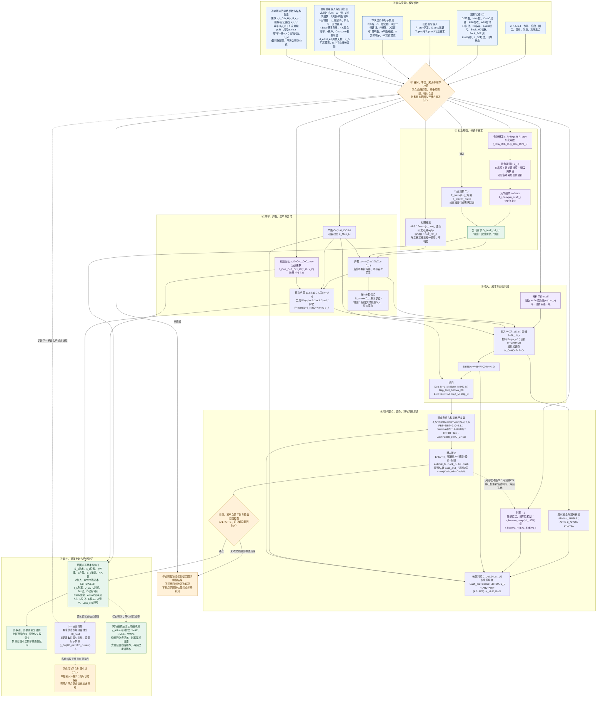

# 完整计算流程图：输入 → 模型过程 → 输出

核对日期：2026-10-12。图示项目已有模型的计算依赖；不是所有版本均已启用的声明。正式2专用版本仍缺需求/效率训练及完整迁移证据。蓝色是输入，紫色是拟合模型，白色是条件计算，绿色是输出，橙色是门槛或缺口；虚线表示反馈、验证或尚待核实的跨回合传播。

## 流程节点与模型文档

| 流程节点 | 模型说明与参数入口 |
| --- | --- |
| 输入分类、训练参数、假设与给定值 | [参数说明](../预测模型与训练参数汇总.md)、[逐回合参数要求](../参数细化与六回合期限要求.md) |
| 行业规模与对照分支 | [行业总需求](TOTAL_行业总需求与增长情景.md)、[绝对需求](ABS_绝对对数需求模型.md)、[等份额基线](BASELINE_等份额基线与实际总量诊断.md) |
| 研发、吸引力、份额与国别需求 | [研发曲线](RD_研发需求乘数曲线.md)、[双国份额](SHARE_双国竞争份额模型.md)、[国别独立份额](COUNTRY_国别独立竞争份额模型.md) |
| 运营、效率、生产与交付 | [运营曲线](OPS_运营效率乘数曲线.md)、[生产效率](EFF_生产效率与运营延续模型.md)、[产能与交付](CAPACITY_产能产量与交付模型.md)、[工资与解聘](LABOR_用工班次工资与解聘模型.md) |
| 材料、其他成本与经营利润 | [材料差额](MATERIAL_原材料单位差额校准.md)、[材料比例](MATERIAL_PROP_原材料单位费用比例模型.md)、[经营利润](OPERATING_收入成本与经营利润模型.md) |
| 利率与财务联立 | [实际利率](INTEREST_实际贷款利率独立模型.md)、[杠杆风险](RISK_POWER_杠杆幂函数风险溢价模型.md)、[权益比风险](RISK_EXP_权益比指数风险溢价模型.md)、[财务联立](FINANCE_利息税利润现金与资产负债联立模型.md) |
| 下期传播、期限与验证 | [公司需求增长](GROWTH_下回合公司需求增长模型.md)、[六回合利润](HORIZON_六回合剩余利润与候选比较.md)、[误差评价](METRICS_模型误差评价计算.md) |
| 组合版本与启用状态 | [unified-market正式1](UNIFIED_unified-market正式1模型组合.md)、[t2v0-um迁移门槛](T2V0_t2v0-um练习2组件及正式2迁移组合.md)、[全部模型索引](README.md) |

数量用千单位，财务用千美元，单价用美元/单位，人数用人；内部利率用小数，独立利率接口用百分数，产能分配a用百分数。σ_M为营销对数尺度，σ_F为解聘补偿比例；曲线b与需求b是不同参数。λ及误差指标只属于训练/评价，不计入经营成本或需求得分。

本图中的主需求分支使用竞争份额；绝对需求与等份额为对照。材料加法/比例和风险幂/指数按选定版本择一，不能相加或拼接。财务当前覆盖零期初库存、零期初短贷、零大客户等已声明条件；非零库存、完整短贷计息、订单和部分跨回合规则仍有缺口。短贷利率预测不等于已实现完整短贷融资链。
