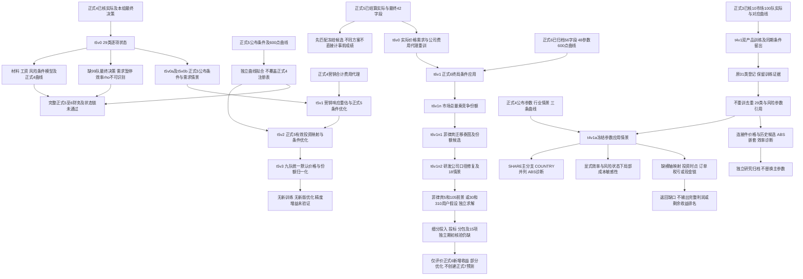
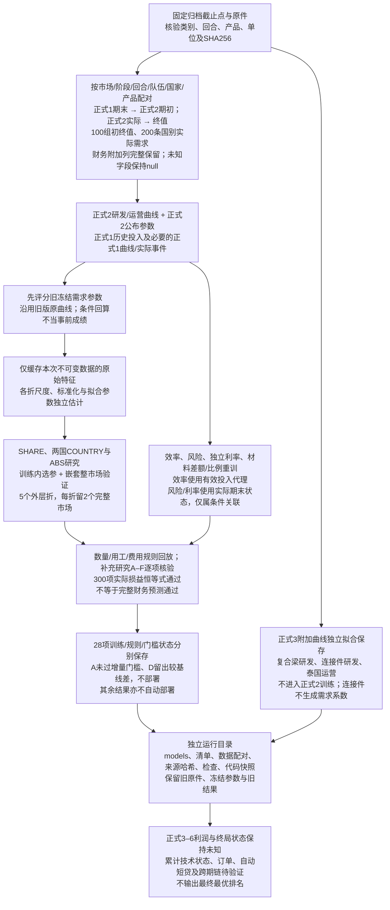
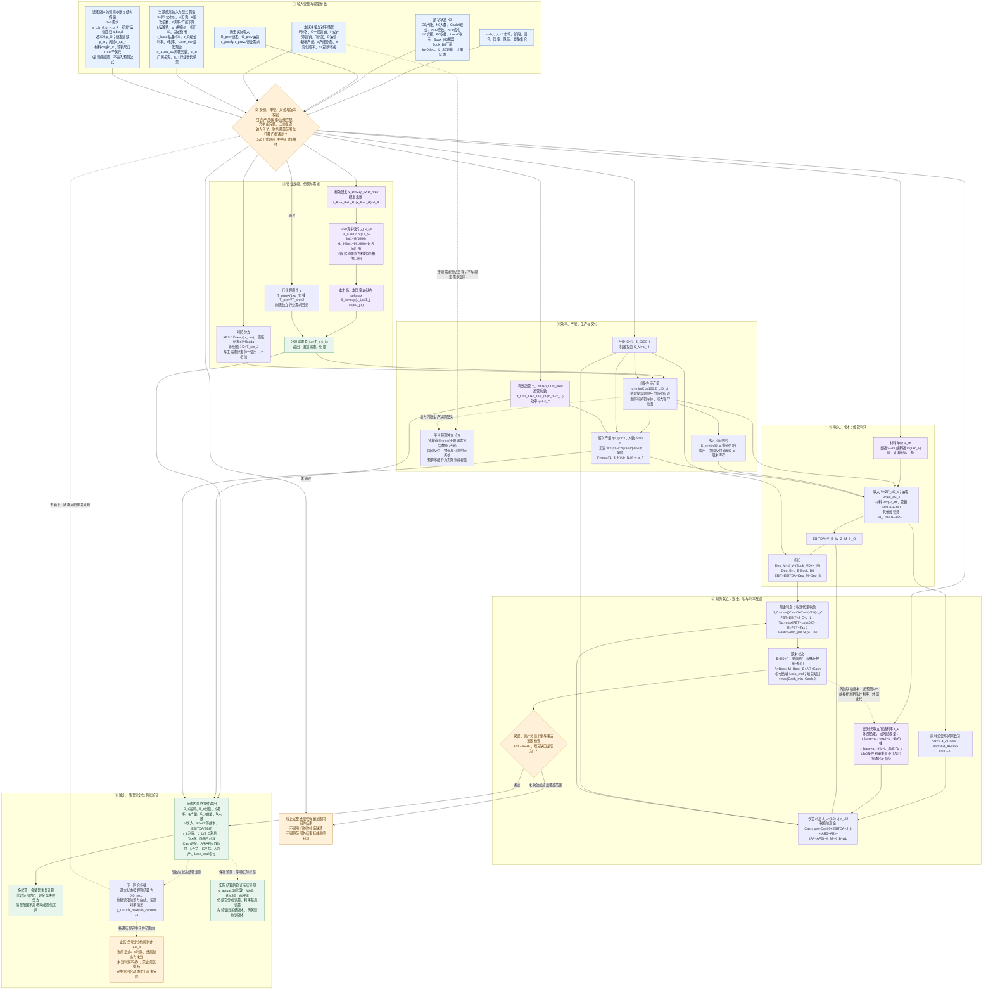

# 完整计算流程图：输入 → 模型过程 → 输出

更新：2026-10-16（北京时间）。本文按所列版本维护专题内容；项目当前状态与最新证据统一见[项目总览](../README.md)。历史公式、参数和误差保留各自版本范围；具体进展在所属主题维护。

**主题导航：** [当前训练与冻结应用流程](#当前训练与冻结应用流程) · [历史流程范围](#历史流程范围) · [已执行：t3v0 数据、训练与核验流程](#已执行t3v0-数据训练与核验流程) · [条件预测：输入、模型依赖与输出](#条件预测输入模型依赖与输出) · [流程节点与模型文档](#流程节点与模型文档) · [相关版本归档](#相关版本归档)

## 当前训练与冻结应用流程

t5v1—t6v1n2接口与边界见[模型索引](README.md)，正式5配对及正式6适配状态见[项目总览](../README.md)。t5v0及正式5曲线的来源与状态见[专题说明](T5V0_正式4训练与缺口.md)。训练、诊断与应用分开；图中t4v1→t4v1a保留正式3训练到正式4历史冻结应用路径。该冻结应用路径不意味着完整财务链已经实现或跨回合验证通过；下文t3v0/t3v1图保留历史接口与假设，其中连接件零标签只属于旧版本。

## 历史流程范围

核对日期：2026-10-13（北京时间）。该历史流程的研究版本为 **t3v0**：正式2需求、效率及可估计组件已重训，正式3曲线独立保存；完整财务预测和跨回合迁移仍未验证，未自动部署。下文先列已执行的训练流程，再列条件预测的计算依赖；第二张图不表示完整链已实现或已通过验收。蓝色是输入，紫色是拟合模型，白色是条件计算，绿色是输出，橙色是门槛或缺口；虚线表示反馈、验证或尚待核实的跨回合传播。

## 已执行：t3v0 数据、训练与核验流程

正式2同回合同国家跨市场共享系数仍是研究假设。需求验证以实际对手策略为条件，不能用来宣称正式3事前成绩。行业总量只作实际诊断、等份额基线和显式增长情景，没有独立行业需求回归。上述顺序与 [t3v0运行入口](../code/model_v2/t3v0.py)、[保存的计算流程](../output/t3v0/20261013T182432038858+0800/calculation_flow.json)及[训练报告](../output/t3v0/20261013T182432038858+0800/report.md)对应。

## 条件预测：输入、模型依赖与输出

## 流程节点与模型文档

| 流程节点 | 模型说明与参数入口 |
| --- | --- |
| 输入分类、训练参数、假设与给定值 | [参数说明](../预测模型与训练参数汇总.md)、[逐回合参数要求](../参数细化与六回合期限要求.md) |
| 行业规模与对照分支 | [行业总需求](TOTAL_行业总需求与增长情景.md)、[绝对需求](ABS_绝对对数需求模型.md)、[等份额基线](BASELINE_等份额基线与实际总量诊断.md) |
| 研发、吸引力、份额与国别需求 | [研发曲线](RD_研发需求乘数曲线.md)、[双国份额](SHARE_双国竞争份额模型.md)、[国别独立份额](COUNTRY_国别独立竞争份额模型.md) |
| 运营、效率、生产与交付 | [运营曲线](OPS_运营效率乘数曲线.md)、[生产效率](EFF_生产效率与运营延续模型.md)、[产能与交付](CAPACITY_产能产量与交付模型.md)、[工资与解聘](LABOR_用工班次工资与解聘模型.md) |
| 材料、其他成本与经营利润 | [材料差额](MATERIAL_原材料单位差额校准.md)、[材料比例](MATERIAL_PROP_原材料单位费用比例模型.md)、[经营利润](OPERATING_收入成本与经营利润模型.md) |
| 利率与财务联立 | [实际利率](INTEREST_实际贷款利率独立模型.md)、[杠杆风险](RISK_POWER_杠杆幂函数风险溢价模型.md)、[权益比风险](RISK_EXP_权益比指数风险溢价模型.md)、[财务联立](FINANCE_利息税利润现金与资产负债联立模型.md) |
| 下期传播、期限与验证 | [公司需求增长](GROWTH_下回合公司需求增长模型.md)、[六回合利润](HORIZON_六回合剩余利润与候选比较.md)、[误差评价](METRICS_模型误差评价计算.md) |
| 当前训练流程、28项状态与版本门槛 | [t3v0正式2重训及正式3附加曲线](T3V0_正式2重训及正式3附加曲线.md)、[运行说明](../code/model_v2/t3v0_README.md)、[28项清单](../output/t3v0/20261013T182432038858+0800/model_inventory.json) |
| 历史组合版本 | [unified-market正式1](UNIFIED_unified-market正式1模型组合.md)、[t2v0-um迁移门槛](T2V0_t2v0-um练习2组件及正式2迁移组合.md)、[全部模型索引](README.md) |

数量用千单位，财务用千美元，单价用美元/单位，人数用人；内部利率用小数，独立利率接口用百分数，产能分配a用百分数。t3v0营销对数尺度为1000千美元；σ_F为解聘补偿比例；曲线b与需求b是不同参数。λ及误差指标只属于训练/评价，不计入经营成本或需求得分。

本图中的主需求分支使用竞争份额；绝对需求与等份额为对照。材料加法/比例和风险幂/指数按选定版本择一，不能相加或拼接。旧条件财务链覆盖零期初库存、零期初短贷、零大客户等已声明条件；t3v0的实际字段配对及损益核验没有解除这些预测限制。非零库存、完整短贷计息、订单、厂房时序、税亏和部分跨回合规则仍有缺口。短贷利率预测不等于已实现完整短贷融资链；正式3曲线保存也不表示正式2参数已通过正式3迁移。

## 相关版本归档

2026-10-13新增 **t3v1**：[同曲线假设及联合分配](T3V1_同曲线假设与联合分配.md)。其条件预测流程如下；连接件无真实训练标签，实际验证未完成。下文t3v0训练及财务依赖图保留原版范围。
